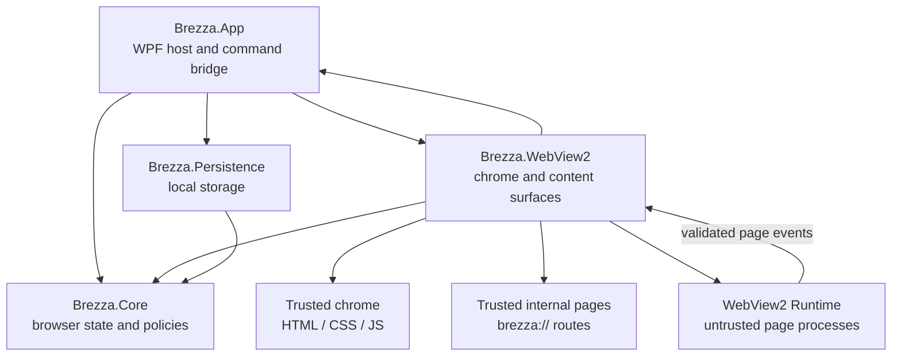

# Architecture

## System Shape

The browser separates durable browser state, trusted browser chrome, trusted internal pages, and untrusted web content. Core owns state and rules; the WPF window is only a host; WebView2 renders both the chrome and the active tab page.

## Project Responsibilities

| Project | Owns | Must not own |
|---|---|---|
| `Brezza.App` (`net48`) | WPF top-level window, trusted chrome command bridge, application composition | WebView2 COM calls, browser state ownership, browser chrome rendering |
| `Brezza.Core` (`netstandard2.0`) | Tab registry/runtime lifecycle, navigation parsing and use-case contracts | WPF, WebView2 SDK, filesystem access |
| `Brezza.WebView2` (`net48`) | Isolated chrome/content environments, WPF WebView2 surfaces, controller lifecycle and event translation | Search policy, tab ordering, persistence |
| `Brezza.Persistence` (`netstandard2.0`) | Versioned settings, history, bookmark, and session stores | UI or WebView2 dependencies |
| `Brezza.Core.Tests` | Deterministic tests of state transitions and policy | WebView2 Runtime behavior |

## Dependency Rules

Allowed project references are `App → Core`, `App → WebView2`, `App → Persistence`, `WebView2 → Core`, and `Persistence → Core`. Core has no project references. The published app targets .NET Framework 4.8; test code runs on .NET 10 against the `netstandard2.0` Core. Do not add a service locator, mediator, or dependency injection framework before a concrete need exists.

## State Ownership

- `TabRegistry` is the source of truth for tab identity, ordering, and the active tab.
- A tab model is durable browser state. A WebView2 host is a disposable runtime resource and is never stored in a view model. Every tab, including the new-tab state, has a logical URL and uses the active content host.
- `TabRuntimeManager` is the single owner of host creation, activation, and closure. It shares an in-flight host creation task per tab and closes late hosts after tab removal or shutdown.
- Implemented lifecycle is `Dormant → Creating → Active`, with failure and closing paths. Suspension is deferred until memory and responsiveness measurements justify it.
- App views render snapshots and send commands through app use cases. They do not mutate core collections or call WebView2 directly.
- The trusted chrome is HTML/CSS/JS loaded from the app's `BrowserUi` assets into a dedicated UI WebView2 environment. WPF only positions this surface and the active content surface. The active tab host renders remote pages and, for internal routes, the trusted local page assets.

## Navigation Flow

The address field submits raw input to `NavigationInputParser`. It returns an empty target, a validated HTTP/HTTPS/file URL, or a search URL built from the configured provider. Search terms are encoded as one query component; typing does not trigger navigation or a provider request.

## Localization

The trusted chrome loads `BrowserUi/locales/en.json` or `BrowserUi/locales/zh-Hans.json` by locale key. Every user-visible chrome label, placeholder, title, tab fallback, settings label, and standard notice is addressed by a translation key. `BrowserSettings.Language` stores `""` for system default or an explicit supported language; `MainWindow` maps the Windows UI culture to `en` or `zh-Hans`, and sends the effective language in the state snapshot. Changing language in Settings writes the preference and reloads the chrome language pack without changing browser state.

## Internal URL Model

Edge-style URLs are resolved by the browser's own protocol handler. They are not ordinary network redirects. Brezza follows the same contract: `brezza://newtab`, `brezza://settings`, `brezza://history`, and `brezza://bookmarks` are canonical browser URLs stored in the active tab. The new-tab URL is presented as an empty address field.

WebView2 does not provide a custom `brezza://` document handler, so the adapter performs an implementation-only translation at the rendering boundary:

| Browser URL | WebView2 resource | Owner |
|---|---|---|
| `brezza://newtab` | `https://brezza.local/newtab.html` | trusted internal page |
| `brezza://settings` | `https://brezza.local/settings.html` | trusted internal page |
| `brezza://history` | `https://brezza.local/history.html` | trusted internal page |
| `brezza://bookmarks` | `https://brezza.local/bookmarks.html` | trusted internal page |

The `brezza.local` virtual-host mapping is never exposed as the browser's logical URL. The active content WebView renders the mapped page in the current tab, so the new-tab page, back/forward, tab activation, session rules, and page lifecycle remain consistent with ordinary navigation. The chrome WebView renders only the toolbar, tab strip, and browser controls.

WebView2 WPF controls are native child windows (HWND airspace): neither HTML `z-index` nor WPF `Panel.ZIndex` lets one surface draw over the other. The chrome therefore owns its own height through the `layout` command, which only the chrome surface may send:

- `height` is the measured height of the tab strip, toolbar, and any notice banner; `MainWindow` sizes the chrome row to it.
- The content surface remains visible for browser-owned pages as well as remote pages; Chrome has no cross-surface overlay state.

Internal pages use the same versioned command protocol as the chrome, but only when the WebView source is the exact trusted `https://brezza.local` origin. Remote pages do not receive a usable bridge. `internalReady` selects the page-specific state payload; page actions (such as `removeBookmark`) return through the same allowlisted command protocol. Commands that control chrome geometry (`BrowserUiCommandParser.IsChromeSurfaceOnly`) are rejected when they arrive from an internal page.

## Trust Boundaries

- Remote pages are untrusted. Their WebView2 settings do not expose the browser command bridge; they receive no native controller reference or host script execution.
- Browser chrome and internal pages use `https://brezza.local/` through WebView2 virtual-host mapping. Only this exact trusted origin may send versioned UI commands; payloads are parsed and allowlisted in App.
- WebView2 process failure is reported by the adapter; automated process recovery is not implemented yet.
- Normal tabs share `%LOCALAPPDATA%\Brezza.Next\WebView2`. Private tabs share a separate per-window `PrivateSessions/{guid}` profile created with WebView2 private mode. The last private tab closes its controllers before the profile directory is removed; application shutdown also closes and cleans the private profile.

## Persistence

`SettingsStore`, `HistoryStore`, `BookmarkStore`, and `SessionStore` write schema-versioned XML through a temporary file and atomic replacement; corrupt or unsupported files fall back to safe defaults. History is recorded after successful normal HTTP/HTTPS navigation and flushed at shutdown. Private tabs are excluded from history and saved sessions. Session restore preserves normal tab identity, order, duplicate URLs, and the active tab; legacy empty tab URLs migrate to `brezza://newtab`, and the store accepts previously opened HTTP/HTTPS, internal, and local file URLs. The default root is `%LOCALAPPDATA%\Brezza.Next`.

## Release

`tools/package.ps1` publishes `net48` as an x64 framework-dependent ZIP. It verifies required assemblies and browser UI assets, checks that `WebView2Loader.dll` matches the x64 RID, removes PDB files and unrelated native loaders, then starts the extracted application with an isolated data root to verify the shipped chrome profile initializes. Users require Windows/.NET Framework 4.8 and the Evergreen WebView2 Runtime; the .NET 10 SDK and reference-assembly package are build-only dependencies.

## Verification

Core tests cover URL/search classification, persistence recovery, trusted-origin checks, command allowlists, concurrent activation, private-session cleanup triggering, close-during-create, and shutdown-during-create. `tools/windows-smoke/smoke.ps1` drives the real WebView2 chrome DOM in a Debug build and covers the trusted new-tab page, page navigation, normal/private tab operations, private-profile cleanup, failure feedback, and session restore across a second process. `tools/package.ps1` publishes an x64 framework-dependent bundle and smoke-tests it with the installed WebView2 Runtime.
