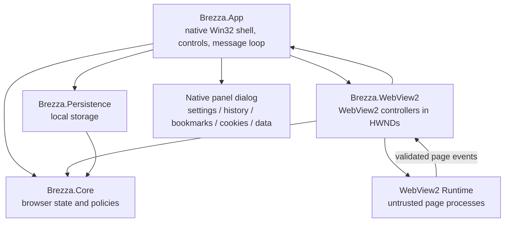

# Architecture

## System Shape

The browser separates durable browser state and policy (Core), the native shell (App), the WebView2 runtime adapter, and local storage. The shell is a native Win32 window whose chrome is standard HWND controls; WebView2 renders only website content, parented to the browser window's HWND.

## Project Responsibilities

| Project | Owns | Must not own |
|---|---|---|
| `Brezza.App` (`net48`) | Native window and controls, message loop, control layout and DPI, localization, native panel dialogs, composition root | WebView2 COM calls, browser state ownership, a second authoritative copy of browser state |
| `Brezza.Core` (`netstandard2.0`) | Tab registry/runtime lifecycle, navigation parsing, search providers, sleep policy, cleanup, download naming, permission policy, browsing-data policy | Win32, WPF, WebView2 SDK, filesystem access |
| `Brezza.WebView2` (`net48`) | Isolated environments, `CoreWebView2Controller` lifetime and event translation, private profiles, profile data access, and cleanup I/O | Search policy, tab ordering, persistence |
| `Brezza.Persistence` (`netstandard2.0`) | Versioned settings, history, bookmark, and session stores | UI or WebView2 dependencies |
| `Brezza.Core.Tests` | Deterministic tests of state transitions and policy | WebView2 Runtime behavior |

## Dependency Rules

Allowed project references are `App → Core`, `App → WebView2`, `App → Persistence`, `WebView2 → Core`, and `Persistence → Core`. Core has no project references. The published app targets .NET Framework 4.8; test code runs on .NET 10 against the `netstandard2.0` Core. No UI framework package is referenced: the shell uses Win32 through P/Invoke. Do not add a service locator, mediator, or dependency injection framework before a concrete need exists.

## Native Shell

`Program` starts a single `[STAThread]` message loop. Local stores load and the saved theme and language are applied before the first frame is shown, so the window never appears in the system palette and is re-themed afterwards. `MessageLoopSynchronizationContext` owns a message-only window and marshals `SynchronizationContext` work onto the UI thread, so every `await` continuation in the shell runs where HWNDs and WebView2 controllers were created. The loop also inspects `WM_KEYDOWN`/`WM_SYSKEYDOWN` before dispatch, which is how browser shortcuts work while the WebView2 surface has focus.

`MainWindow` registers the `BrezzaMainWindow` class and creates the chrome as child controls:

| Control | Class | Purpose |
|---|---|---|
| Tab strip | `SysTabControl32` | Tab icons and titles, selection, tooltips for long titles |
| Close active tab | `BUTTON` | Closes the tab Core tracks as active |
| New tab | `BUTTON` | Creates a normal tab |
| Toolbar menu | `BUTTON` | Opens a menu with new tab, new private tab, history, bookmarks, cookies, browsing data, and settings (Alt+F) |
| Back / forward / reload | `BUTTON` | History navigation |
| Address and search | `COMBOBOX` (drop-down) | Raw input submission; drop-down lists history and open tabs |
| Bookmark | `BUTTON` | Toggles a bookmark for the active page |
| Caption buttons | `BUTTON` | Minimize, maximize or restore, and close the window |
| Notice area | `STATIC` + `BUTTON` | Failure, download, permission, and cleanup notices with optional reload and dismiss |
| New-tab page | `STATIC` | Title and subtitle of the empty new-tab state |

Owner-drawn controls suppress `WM_ERASEBKGND` and paint their whole rect, so no system-colored erase step shows on the dark palette.

Theme and tokens (ADR 0008):

- `NativeThemePalette` (`Native/NativeTheme.cs`) is the theme: two static instances, `Light` and `Dark`, holding only color roles (`Frame`, `Surface`, `Field`, `Text`, `Accent`, …) and a `Scheme` that selects the Windows light or dark rendering of standard controls. `Backdrop(FlatBackdrop)` and `TextOn(FlatBackdrop)` map a control's backdrop role to its colors. No other file defines a color.
- `NativeThemeSource` is the single source of the active theme. `BrowserShell` owns it and sets the mode; `MainWindow` and `InternalPanelWindow` take it in their constructors and repaint on its `Changed` event. `WM_SETTINGCHANGE` with `ImmersiveColorSet` calls `RefreshSystem()`, which raises `Changed` only when the resolved palette changes.
- `NativeThemeResources` is per-window: cached GDI brushes for the current palette and the dark visual classes (`DarkMode_Explorer`, `DarkMode_CFD`) for standard controls.
- `NativeMetrics` (`Native/NativeMetrics.cs`) holds the shared size tokens (radii, spacing, control heights) in unscaled pixels. They are not part of a theme. Sizes that belong to one control's own layout stay constants in that class.
- A content surface is not a native window, so `BrowserShell` carries the theme to it: the surface color and the `prefers-color-scheme` preference are set before the surface becomes visible and again when the theme changes.

Layout is computed in physical pixels from the window DPI. `WM_SIZE` repositions the controls and updates the active controller's `Bounds`; `WM_DPICHANGED` applies the suggested rectangle, rebuilds the fonts, and updates `RasterizationScale`. The app manifest declares `PerMonitorV2` awareness and a Common-Controls 6 dependency, so the controls follow the Windows visual style.

The tab strip is subclassed (`SetWindowSubclass`) so middle-click closes a tab and the wheel scrolls the strip; the address field's edit child is subclassed so Enter submits and Escape reverts. `TCN_SELCHANGE` activates the tab the user clicked; `TCM_SETCURSEL` only reflects Core's active tab, because a tab control does not notify for programmatic selection.

Each tab's favicon is painted in the strip ahead of its title. Core tracks only the favicon URI (`BrowserTab.FaviconUri`, updated from the host's `FaviconChanged` event and synced again on navigation completion); `TabFaviconCache` in the shell turns that URI into a decoded `Bitmap` per tab and repaints the strip when one arrives. The image is fetched with `ITabHost.GetFaviconAsync` through the tab's own host, so the request stays inside the page's profile and network stack, and the cache is keyed by tab rather than by host, so an icon survives its host sleeping or being released. Every tab leads with an icon: its favicon when it has one, otherwise the built-in globe glyph from the same icon font. A private tab leads with its private marker alone and keeps the page's own title, so the privacy mark is said once instead of three times. A tab's label is always painted and ellipsized into the room that is left; the minimum tab width is derived from what a tab must still show — its leading icon, the room for that ellipsis, and the active tab's close button — so a tab at the minimum width keeps its favicon and its close target instead of clipping either.

Because the strip's window is as wide as its items so the tab control never scrolls them itself, that width runs past the band the strip shows. The window's own region is clipped to the band, so a tab scrolled out of view neither paints over the caption row beside the new-tab button nor answers the mouse there — and, because the new-tab button and the caption buttons sit below the strip in the z-order, the strip cannot paint over and erase them while it is scrolled away from its end. The strip shows that it scrolls with a thin indicator under the tabs: a track spanning the band and a thumb whose width is the share of the strip that is visible, so a small thumb means much is off screen and the thumb's place is where the view sits. It is the only affordance the scrolling has, and it is drawn only while the strip can scroll.

The room the tabs share is divided with a division that rounds up, so the strip fills the band as soon as the tabs reach it and the new-tab button beside it stops moving; past that point the strip is wider than the room it shows and scrolls instead.

The strip's window width is taken from the control's own last item rectangle rather than estimated, and the window is widened before the items are laid out. A tab control whose items do not fit its window builds its own `msctls_updown32` scroll arrows and keeps them once built, so an estimated width that falls short leaves those arrows behind for the shell to hide again on every layout — a control that is hidden after the fact rather than never made. Sized this way the items never overflow and the arrows are never built.

A scroll step moves the strip and clips its region without redrawing either, then invalidates the strip once, so the strip is never painted at the new offset under the old region, and it repaints none of the controls a scroll does not change. The strip is also scrolled before the selection moves: the tab control repaints for a selection change on its own, so scrolling first makes that repaint and the strip's repaint at the new offset the same paint, instead of the row being painted once still at the old offset.

## WebView2 Hosting

`WebView2TabHost` owns one `CoreWebView2Controller` per tab, created with `CreateCoreWebView2ControllerAsync` against the browser window's HWND. Controller options are always supplied; private tabs set `IsInPrivateModeEnabled`. The host configures the surface so remote content cannot reach the browser:

- `IsWebMessageEnabled = false` and no `WebMessageReceived` handler is registered.
- `AreBrowserAcceleratorKeysEnabled = false`, so the native window owns shortcuts.
- Default context menus stay enabled for the page; the runtime's own download dialog is suppressed.
- The controller is created with the shell palette color through the controller options, and the color is applied before the surface becomes visible, so a surface that has not painted yet shows the chrome background instead of the runtime's default white. Rendered pages keep controlling their own pixels.

`ITabHost` exposes the view surface the shell needs without exposing COM objects: `SetVisible`, `SetBounds`, `SetRasterizationScale`, `SetBackgroundColor`, `SetPrefersDarkColorScheme`, and `Focus`. It also exposes the current document's `FaviconUri`, a `FaviconChanged` event, and `GetFaviconAsync`, which returns the favicon image the runtime fetched inside the host's own profile; an empty stream (a document without a favicon) is reported as null. Only the active tab's host is visible. Controller creation failures complete the host's creation task with the exception, so a tab that cannot render reports a failure instead of waiting forever. Closing a tab while its controller is still being created closes the controller as soon as it exists.

## Browser-Owned Views

Settings, history, bookmarks, cookies, and browsing data are native panels in one owned dialog
(`BrezzaInternalPanel`) built from combo boxes, edit fields, a list box, and buttons. The panel
reports intent (save settings, open a URL, remove an entry, remove a cookie, clear history, clear
browsing data) and renders the data it is given.

Every panel is a toolbar view with no browser URL of its own (ADR 0010). It is opened from the
toolbar menu — history (Ctrl+H), bookmarks, cookies, browsing data (Ctrl+Shift+Delete), and
settings — and closes when the user navigates, switches tabs, presses Escape, or uses the panel's
own close action. No tab holds a panel, no tab URL names one, and no WebView2 surface is created for
one. The `brezza` scheme is not navigable any more, so a `brezza://` address typed into the address
field is searched like any other text.

| Panel | Content | Row action | Footer action |
|---|---|---|---|
| Settings | search provider, language, theme, startup behavior | — | Save / Cancel |
| History | visited pages (filter, open) | remove entry | Clear history |
| Bookmarks | saved pages (filter, open) | remove entry | — |
| Cookies | the profile's cookies (filter) | delete that cookie | Clear cookies |
| Browsing data | the four data categories | clear that category | Clear all |

The cookies panel lists every cookie the normal profile stores: the name over where it lives, when
it ends (or that it is a session cookie), and the flags the site set. The browsing-data panel lists
cached files, website storage, service workers, and cookies, each with what it covers; it shows no
size, because WebView2 exposes no per-category size and a measured profile folder is mostly runtime
data that no clear touches.

A per-row action that only removes one of the user's own entries runs without asking, like removing
a bookmark. Anything that clears a category, clears all cookies, or clears history asks first, and
every outcome is reported through a notice. All of them act on the normal profile only.

## State Ownership

- `TabRegistry` is the source of truth for tab identity, ordering, and the active tab.
- A tab model is durable browser state. A WebView2 host is a disposable runtime resource and is never stored in a view model. An empty URL is the lightweight new-tab state and has no content host until navigation begins.
- `TabRuntimeManager` is the single owner of host creation, activation, sleep, and closure. It shares an in-flight host creation task per tab and closes late hosts after tab removal or shutdown.
- Implemented lifecycle is `Dormant → Creating → Active`, with `Sleeping`, failure, and closing paths. Empty-url tabs are rendered by the native shell; inactive hosts are eligible for bounded sleep.
- Sleep requires eligibility: `TabSleepPolicy` releases an inactive host only when it is not loading, not playing audio, and not showing a full-screen element. The sweep keeps the eight-host budget and ten-minute inactivity threshold, and skips ineligible candidates. Reactivation reloads the saved URL; DOM and form state are not preserved when a host is released.
- App views render snapshots and send commands through app use cases. They do not mutate core collections or call WebView2 directly.

## Navigation Flow

The address field submits raw input to `NavigationInputParser`. It returns an empty target, a validated HTTP/HTTPS/file URL, or a search URL built from the configured provider. Search terms are encoded as one query component; typing does not trigger navigation or a provider request. Provider presets (Bing, Google, DuckDuckGo, Baidu) are owned by Core (`SearchProviderPresets`) so the native settings panel and persistence share one definition.

## Localization

The native shell reads `BrowserUi/locales/en.json` or `BrowserUi/locales/zh-Hans.json` and applies every label, button text, notice, tab fallback, and panel string from those packs. `BrowserSettings.Language` stores `""` for system default or an explicit supported language; the shell maps the Windows UI culture to `en` or `zh-Hans` and sends the effective language with each state snapshot. Changing language in Settings writes the preference and re-applies the native labels without changing browser state.

## Trust Boundaries

- Remote pages are untrusted. A content host starts with the message bridge disabled and never registers a message handler, so no page can address the browser even though the page messaging object exists in the document. There is no browser-owned HTTP origin: the `brezza.local` virtual-host mapping is gone, so a page that tries to read browser assets or navigate into a browser-owned page gets an ordinary network failure.
- Only the browser opens its own views, and they are toolbar views rather than routes: a remote document cannot navigate the shell into a panel, no browser-owned document is ever served to a page, and the `brezza` scheme is not navigable, so a page that tries to reach one gets an ordinary network failure or a search.
- WebView2 process failure is reported by the adapter; automated process recovery is not implemented yet.
- Normal tabs share `%LOCALAPPDATA%\Brezza\WebView2`. Private tabs share a separate per-window `PrivateSessions/{guid}` profile created with WebView2 private mode. The last private tab closes its controllers before the profile directory is removed; application shutdown also closes and cleans the private profile.

## Browser-Owned Requests

Downloads, popups, and permission requests are decided by Core and translated by the adapter:

| Request | Core contract | App behavior |
|---|---|---|
| Download | `BrowserDownloadPaths` sanitizes and de-duplicates the file name using an adapter-supplied existence check; Core performs no filesystem I/O | Downloads go to the configured folder with start/completion/failure notices; the runtime's own download dialog is suppressed |
| Popup | `PopupRequested` carries the requested destination and originating session kind | HTTP/HTTPS destinations open in a tab of the same session; blank requests open an empty tab; other schemes are ignored |
| Permission | `BrowserPermissionPolicy` grants nothing without a prompt | The request is denied and reported through a notice |

## Private Session Cleanup

`ITabHostFactory.CleanupSessionAsync` returns a `SessionCleanupResult` with `Completed`, `Pending`, or `Failed`, the data folder, the number of deletion attempts, and the last failure detail. `Completed` requires verified removal. A folder that is not verified removed stays tracked by the factory and by `TabRuntimeManager`, which exposes `PendingPrivateCleanup`, `RetryPendingPrivateCleanupAsync`, and the `PrivateCleanupCompleted` event. Cleanup attempts are serialized; timer retries run only while no private tabs are open. The shell shows a notice while removal is pending or failed, and shutdown makes a final attempt after closing hosts.

## Persistence

`SettingsStore`, `HistoryStore`, `BookmarkStore`, and `SessionStore` write schema-versioned XML through a temporary file and atomic replacement; corrupt or unsupported files fall back to safe defaults. Settings schema version 2 adds a `theme` value (`System`, `Light`, or `Dark`), schema version 3 adds a `startupBehavior` value (`NewTab` or `RestoreSession`), and files of either older schema load with the new-tab default. History is recorded after successful normal HTTP/HTTPS navigation and flushed at shutdown. Private tabs are excluded from history and saved sessions. Session restore preserves normal tab identity, order, duplicate URLs, and the active tab; a tab saved on a browser-owned page reopens as an empty new-tab page, and the store accepts previously opened HTTP/HTTPS and local file URLs. The session is saved at every shutdown, but `BrowserShell` only loads it when the stored `startupBehavior` asks for it, so the default start is one new-tab page. The default root is `%LOCALAPPDATA%\Brezza` (ADR 0006).

Cookies and the data sites store are profile data owned by WebView2, not XML stores. Core defines the contract (`IBrowserDataManager` with `GetCookiesAsync`, `RemoveCookieAsync`, `ClearAsync(BrowserBrowsingDataKind)`, `BrowserCookie`, and an observable `BrowsingDataClearResult`) and the adapter implements it against the normal profile's cookie manager and clear-browsing-data API, so the shell reads and clears profile data without touching a WebView2 object. Core owns which categories exist (`Cache`, `SiteData`, `ServiceWorkers`, `Cookies`, and their sum `All`); the adapter maps them onto the runtime's data kinds, so a clear never removes more than the panel showed. Every clear returns an observable result and is reported; a task that clears profile data is never discarded silently. A single deletion is applied by the runtime after the call returns, so the adapter reads the store back until the cookie is gone before it reports success. The adapter reaches the profile through a hidden management controller that is never visible and never navigates, so the data tools work while no tab holds a content host.

## Release

`tools/package.ps1` publishes `net48` as an x64 framework-dependent ZIP named for the native shell. It verifies required assemblies and the language packs, checks that `WebView2Loader.dll` matches the x64 RID, merges the managed assemblies into one `Brezza.exe` with ILRepack from the pinned local tool (ADR 0009), removes PDB files, the RID-specific native folder, and the unused WPF/WinForms WebView2 assemblies, then starts the extracted application with an isolated data root to verify its native window, controls, and WebView2 content surface; `-SkipLaunchVerification` skips that last step for CI runs without an interactive desktop. The package therefore holds `Brezza.exe`, `WebView2Loader.dll`, and the language packs. Users require Windows/.NET Framework 4.8 and the Evergreen WebView2 Runtime; the .NET 10 SDK and reference-assembly package are build-only dependencies.

## Verification

Core tests cover URL/search classification, provider presets, persistence recovery, sleep eligibility, host release, observable session cleanup with retry, concurrent activation, private-session cleanup triggering, close-during-create, and shutdown-during-create. `tools/smoke.ps1` drives the real native controls in a Debug build and covers the new-tab page, native panels for settings/history/bookmarks/cookies/browsing data, page navigation, a `brezza://` address being searched instead of opening a panel, the cookies panel's list/filter/row-delete/clear-all through the real controls, the browsing-data panel's category and clear-all actions through the menu command and Ctrl+Shift+Delete, the remote-content boundary (no bridge, no browser assets, no browser-owned page), normal/private tab operations through the native tab strip, private-profile cleanup, failure feedback, and session restore across a second process once the startup setting asks for it, with the default start staying on the new-tab page. The harness serves a local HTTP origin that plants the cookies the panel is driven against and acts as the search provider, so the run stays off the public network. `tools/package.ps1` publishes an x64 framework-dependent bundle with the managed assemblies merged into one executable and smoke-tests it with the installed WebView2 Runtime. The driver is compiled into Debug builds under `#if DEBUG` and split into `BrowserShell.Smoke*.cs` partial files by concern.

GitHub Actions runs two workflows: `ci.yml` restores, builds Release, and runs the Core tests through `tools/test.ps1 -Stage Unit` on pushes and pull requests to `main`, uploading the TRX results; `release.yml` runs on a `v*` tag push (or a manual run naming a tag), builds and tests the same way, packages with the merge, and publishes a GitHub Release whose pre-release flag follows a suffix in the tag. The Windows smoke and the package launch check need an interactive desktop and the WebView2 Runtime, so neither runs in CI.
